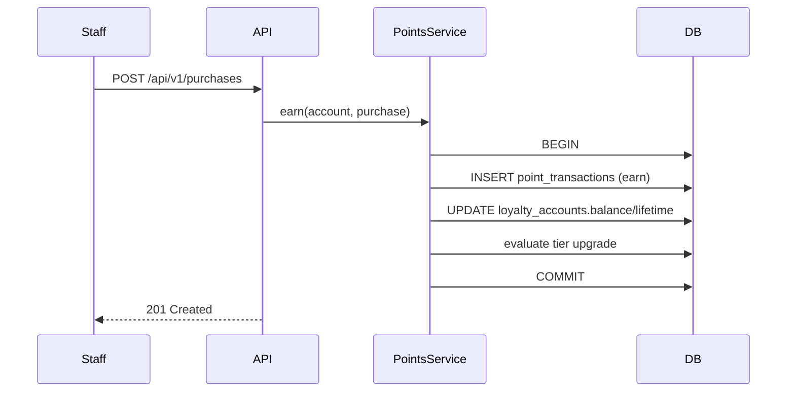
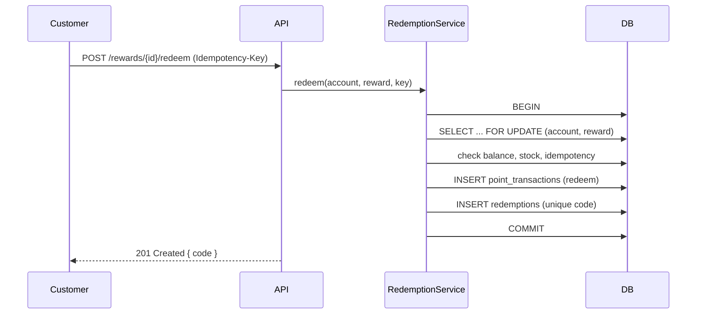

# Architecture

This document describes how the Loyalty & Rewards API is structured and how a
request flows through it. It is written for someone reviewing the codebase for
the first time.

## Layered design

Controllers stay thin: they validate the request, delegate to a service, and
shape the response with an API Resource. Business rules live in services so they
can be unit-tested without HTTP.

```
HTTP request
    │
    ▼
FormRequest ──► Controller ──► Service ──► Models ──► MySQL
                    │             │
                    │             ├── DB::transaction when >1 table is touched
                    │             └── Redis (cache / locks / queue)
                    ▼
               API Resource ──► JSON response
```

## Core invariants

1. `loyalty_accounts.points_balance` equals the sum of `points` over that
   account's `point_transactions` rows. Enforced by a test and by the
   `loyalty:reconcile` Artisan command.
2. `point_transactions` is **append-only**: rows are inserted, never updated or
   deleted, so the history is always auditable.
3. Money is stored as integer **cents** (`amount_cents`), never floats.

## Purchase to ledger



## Reward redemption



## Directory conventions

| Path                     | Responsibility                                  |
| ------------------------ | ----------------------------------------------- |
| `app/Enums`              | Typed enums instead of magic strings             |
| `app/Services`           | Domain logic and transactions                    |
| `app/Jobs`               | Queued work (points awarding, expiry)            |
| `app/Policies`           | Authorization rules                              |
| `app/Http/Requests`      | Input validation                                 |
| `app/Http/Resources`     | Response shaping                                 |
| `app/Console/Commands`   | Operational Artisan commands                     |

## Decision records

Architecture decisions are captured in [`adr/`](adr). Start with
[ADR 0001](adr/0001-record-architecture-decisions.md).
